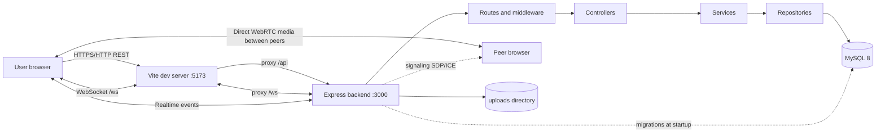

# LAN-Media System Survey Report

> Source survey document as of 02/10/2026. This content describes the current repository state, not a specification for future features. The flows are inferred from the existing frontend, API, services, repositories, migrations, and configuration.

## 1. Project summary

LAN-Media is a LAN-priority multimedia communication application currently organized as a **modular monolith**: the React/Vite frontend and Express/Node backend run as separate components in the same repository; the backend provides REST APIs, WebSockets, authentication, business logic, and MySQL access. Files are transferred over HTTP and stored in a local directory, while call signaling uses WebSockets and media uses WebRTC between browsers.

The main backend/frontend capabilities already implemented include:

- Registration, login, session restoration via cookies, and logout.
- User directory, online status based on WebSocket connections.
- Direct and group conversations, message history, real-time messages, and typing status.
- File upload, file-message notifications, listing files in conversations, and download checks with permission validation.
- One-to-one voice/video calling: ringing, accept/reject/end flow, SDP/ICE exchange over WebSocket, and media transport via WebRTC.
- Automatic MySQL migrations on backend startup; local or Docker Compose execution is supported.

Important limitations to state accurately in presentations:

- “LAN-first” is an implementation direction for private-network deployment; the application does **not currently auto-discover LAN servers**. There is a `LanDiscovery` / `NetworkManager` module, but it is not yet integrated into startup or the UI flow.
- Files are stored on the local filesystem of the backend host; there is no object storage, replication, or malware scanning yet.
- Calls have signaling and WebRTC client code, but the server keeps call state in memory; the `calls` table is not currently used by `CallService` to record history. There is no TURN server configured beyond the default STUN server.
- The UI contains several sample pages/features. `ChatPage` is the real chat interface using the API; `FilesPage` and `CallPage` are routing placeholders. In `App`, protected routes often render `DemoWorkspace`, so tabs in the sample workspace should not be interpreted as complete product screens.
- The README explicitly mentions that the WebRTC phase was not implemented, while the current code already includes signaling/WebRTC. This means the README is behind the implementation in this area; this report relies on the current source as the primary reference and notes these differences.

## 2. Overall architecture

### 2.1 Component diagram



In development, the browser connects to the same origin as Vite. Vite forwards `/api` and `/ws` requests to the backend. When deployed without the Vite dev server, the proxy layer must be replaced with an equivalent reverse proxy and HTTPS/WSS setup. The backend binds to `0.0.0.0:3000` by default, and Vite binds to `0.0.0.0:5173`.

### 2.2 Backend layers

1. **Routes** declare endpoints and apply `requireAuth` for private routes.
2. **Controllers** translate HTTP requests into service calls, read the authenticated user from `response.locals`, format responses, and pass errors to middleware.
3. **Services** enforce business rules, membership/admin permissions, data limits, and orchestrate repository calls.
4. **Repositories** encapsulate MySQL queries by entity.
5. **Database/Migrations** create the `mysql2/promise` pool and apply schema versions sequentially.
6. **WebSocket handlers** authenticate sessions during upgrade/connection, decode events, call services, and forward events to the proper connections.

This is a modular monolith, not a microservice architecture: all modules share the same backend process, database, configuration, and connection manager.

### 2.3 Frontend

The frontend is a React + TypeScript SPA. `App.tsx` handles simple route selection based on `window.history`, login state, health checks, WebSocket connections, and application-level call hooks. The `api/` folder contains HTTP/realtime clients; `hooks/` manages auth/chat/call behavior; `pages/` defines screens; `components/` holds reusable UI pieces; CSS is organized into global styles and page-specific styling.

`useWebSocket` / `RealtimeClient` uses a shared realtime connection; the backend authenticates the session cookie during the WebSocket handshake. `useChat` / `ChatPage` calls REST for lists and history, then uses WebSockets for push updates. `useCall` creates an `RTCPeerConnection` in the browser and sends control signaling over the same WebSocket.

## 3. Folder tree and responsibilities

```text
LAN_Media/
├── backend/
│   ├── src/
│   │   ├── controllers/       # HTTP handlers; wire services and repositories
│   │   ├── core/
│   │   │   ├── config/        # Read and validate environment variables
│   │   │   ├── database/      # MySQL pool, migration runner, migrations
│   │   │   ├── errors/        # Shared ApiError
│   │   │   ├── middleware/    # CORS, not-found, error handling
│   │   │   ├── network/       # NetworkManager/LanDiscovery (not yet integrated)
│   │   │   └── security/      # Password hashing, token utilities, auth middleware
│   │   ├── models/            # Domain types: User, Message, File, Call...
│   │   ├── repositories/      # MySQL queries and mappings
│   │   ├── routes/            # Express endpoint declarations
│   │   ├── services/          # Auth, chat, file, call, user, health...
│   │   ├── types/             # Express type augmentation
│   │   ├── websocket/         # WebSocket server, connection manager, handlers
│   │   └── main.ts            # App assembly, WS setup, migration, listen
│   └── tsconfig.json
├── frontend/
│   ├── src/
│   │   ├── api/               # Auth/Chat/File/User/Health and realtime client
│   │   ├── components/        # common, chat, call
│   │   ├── hooks/             # useAuth/useChat/useCall/useWebSocket
│   │   ├── pages/             # Login/Register/Chat/Files/Call/Settings...
│   │   ├── styles/            # reset, variables, global, demo
│   │   ├── App.tsx            # Route orchestration, auth, and workspace
│   │   └── main.tsx           # React entry point
│   ├── index.html
│   ├── vite.config.ts         # Optional HTTPS and REST/WebSocket proxy
│   └── tsconfig.json
├── docs/database/             # DB guide and setup.sql
├── tests/
│   ├── unit/                  # Service/repository/security tests
│   └── integration/           # Health/auth/chat/files tests
├── storage/                   # Placeholder folders by content type
├── uploads/                   # Local file store currently in use
├── docker-compose.yml
├── README.md
├── BAOCAO.md
└── package.json
```

## 4. Functional flows

### 4.1 Startup and health checks

1. `npm run dev` uses `concurrently` to run the backend and Vite; the backend builds once, then runs TypeScript watch and Node watch.
2. `backend/src/main.ts` loads dotenv, creates Express, configures CORS/JSON, mounts routes, installs error handlers, and attaches the WS server to the HTTP server.
3. The backend runs `runMigrations(database)`. If the DB is not ready, it logs errors and still opens HTTP/WS in degraded mode; functionality that depends on the DB may fail.
4. The server listens on `HOST`/`PORT`.
5. The frontend calls `GET /api/health` and shows the health/database status. Vite proxies these requests to the backend.

### 4.2 Registration, login, and session management

**Registration:** `RegisterPage` → `useAuth` / `AuthApi` → `POST /api/auth/register` → `AuthController` → `AuthService`. The service normalizes username/email, validates length and format, checks for duplicates, hashes the password with scrypt, creates the user, generates a random token, and stores the **token hash** with the session expiration. The controller sets an HttpOnly cookie, `SameSite=Lax`, and returns public user data.

**Login:** the client sends identifier/password → repository looks up the user → service verifies the scrypt hash (and uses a dummy hash when the user does not exist to reduce timing differences) → creates a new session → returns a session cookie. When the app loads, `useAuth` calls `/api/auth/me` to restore the user from the cookie.

**Protected routes:** `requireAuth` reads the session cookie, hashes the token, verifies the session has not expired or been revoked, and attaches the user to `locals`. Logout revokes the token hash in the DB and clears the cookie. WebSockets also send the same cookie on the same origin; the server validates the session during the handshake.

### 4.3 Contacts, presence, and realtime connections

1. When an authenticated user connects to `/ws`, the server checks the origin (if present), the cookie, and the DB session.
2. `ConnectionManager` registers the socket under the user. One user may have many tabs/devices.
3. The first socket that makes a user online emits `presence.online` to other online users; closing the socket emits `presence.offline` only when the user's last socket closes.
4. The UI fetches the contact list and online users via REST (`/api/users`, `/api/users/online` as assembled in routes) and updates presence via WS events.
5. WS handlers route call events (`call_*`, signaling, `end_call`) to `CallHandler`; all other events are sent to `ChatHandler`.

Presence is runtime in-memory state, not a reconstructed state from the `devices` table. When the backend restarts, the socket map is rebuilt from scratch.

### 4.4 Direct chat, group chat, and messages

**Open direct chat:** UI selects a contact → `POST /api/conversations/direct` → service verifies the other user exists and is not the same user → repository creates or finds a direct conversation → returns members and conversation data.

**Create group:** UI collects a name and member usernames, then sends `POST /api/conversations/group` with `name` and `memberIds`. The service checks the name length (1–160 chars), requires at least one other user, and validates each user. The repository creates the group and marks the creator as `ADMIN`. Admins can add/remove members; the last admin cannot be removed. Inactive members are marked with `left_at`.

**Load history:** UI calls `GET /api/conversations/:id/messages?limit=...&before=...`. The controller validates the parameters; the service checks membership, clamps the max amount to 100, and the repository paginates by timestamp. The history API requires ongoing access to the conversation.

**Send realtime messages:** UI sends `{type:"chat.send", payload:{conversationId, content}}` over WS. The handler parses JSON → `ChatService.send` validates membership, trims content, checks for empty or overlong values (default 4000) → saves to MySQL → fetches conversation members → emits `chat.message` to the relevant sockets. The browser receives the event, deduplicates by message id, and updates the list. Persisting before broadcasting ensures recipients can reload and still see the message.

REST `POST /api/conversations/:id/messages` also sends messages and broadcasts the event. Typing events use `chat.typing.start` / `chat.typing.stop`; the server checks membership and only forwards them to other members, without persist in DB. Errors are returned as structured events.

### 4.5 Sending and receiving files

1. The user selects a file in the composer; the frontend keeps it locally and shows the name and size.
2. When sending, `FileApi.upload` creates a multipart `XMLHttpRequest` with field `file`, sends credentials cookies, and adds the `X-Conversation-Id` header; the XHR reports upload progress.
3. `requireAuth` authenticates the session. `FileService` confirms the user is an active member before accepting content; Busboy limits one file, file size, and field count, and validates file names and the configured type whitelist.
4. Bytes are streamed to `UPLOAD_DIR` with a random UUID as the storage key instead of user-controlled paths. File metadata is saved to MySQL and then a `FILE` message is linked to the record. If any later step fails, the service removes the temporary files and related metadata.
5. The controller broadcasts a `chat.message` containing the file metadata to the members. The UI updates the file message and refreshes the shared file list.
6. Download requests call `GET /api/files/:fileId/download`; the backend resolves metadata, validates chat membership and storage path, confirms the file exists, then streams the response with safe `Content-Disposition`, `nosniff`, and `private, no-store` headers.
7. The frontend reads the stream, updates progress, and uses a Save File Picker when supported; otherwise it falls back to the browser download flow.

File messages only transfer metadata via realtime; actual binary content is sent over HTTP. There is no binary transfer through WebSockets. The route/API exists, but `FilesPage.tsx` is still a placeholder. Real upload/download behavior is integrated into `ChatPage`.

### 4.6 Voice and video calls

**Initiation:** from a direct chat, the caller selects voice/video (UI only enables when the contact is online) → `useCall.start` emits `call_user` over WebSocket. `CallHandler` verifies the target exists and is online; `CallService` checks that the caller is not calling themselves, neither side is busy, and creates a call id/status in memory. The server sends `incoming_call` to the callee and `call_ringing` to the caller.

**Accept or reject:** the callee accepts after granting camera/microphone permission; the browser calls `getUserMedia` and sends `call_accept`. The server moves the status to `accepted` and reports `call_accepted` to the caller. Rejecting sends `call_reject`, the server releases the session, and both parties are notified.

**Peer setup:** the caller creates an `RTCPeerConnection` with configured ICE servers, attaches local tracks, creates the SDP offer, and emits `webrtc_offer`. The callee sets the remote description, applies queued ICE candidates, creates an answer, and emits `webrtc_answer`. The two peers exchange ICE candidates via `ice_candidate` over the backend relay.

**During the call / end call:** the UI shows local and remote streams, duration, mute, and camera toggles. Ending sends `end_call`; the server emits `call_ended` and clears the in-memory session. WebSocket disconnection also cleans up active calls for that user. The browser closes the peer connection, stops media tracks, and clears the streams.

Real-world conditions: camera/microphone access requires HTTPS or localhost secure context; peer connection setup may fail if NAT/firewall traversal requires TURN. The sample configuration only includes Google STUN. There is no call history persistence in the current flow even though the `calls` table and a sample UI page suggest it.

### 4.7 Accounts, settings, and incomplete pages

`SettingsPage.tsx` exists, but the app's protected route often renders `DemoWorkspace`. That workspace contains many demo components and sample content; some settings are only in session state, some actions show “under development,” and there is no backend API for them yet (profile image update, password changes, call history, real network config). `FilesPage.tsx` and `CallPage.tsx` call a `PagePlaceholder`, which renders “Coming soon.” Therefore, when describing product status, one must distinguish between **backend capability**, **hook/component implementation**, and **fully connected user-facing screens**.

## 5. REST API and websocket events

### 5.1 Main REST API

| Method / path | Auth | Purpose |
|---|---:|---|
| `GET /api/health` | No | Backend health and DB status. |
| `POST /api/auth/register` | No | Create account and session. |
| `POST /api/auth/login` | No | Login and set a session cookie. |
| `POST /api/auth/logout` | Cookie if present | Revoke session and clear cookie. |
| `GET /api/auth/me` | Yes | Get current user from the active session. |
| `GET /api/users`, `GET /api/users/online` | Yes | Contact list and online users. |
| `GET /api/conversations` | Yes | List conversations for the user. |
| `POST /api/conversations/direct` | Yes | Create/find a direct conversation. |
| `POST /api/conversations/group` | Yes | Create a group. |
| `GET /api/conversations/:id/messages` | Yes | Paginated message history. |
| `POST /api/conversations/:id/messages` | Yes | Send a text message over HTTP. |
| `POST/DELETE /api/conversations/:id/members...` | Yes | Admin member management. |
| `POST /api/files/upload` | Yes | Upload a multipart file, requires `X-Conversation-Id`. |
| `GET /api/files/:fileId/download` | Yes | Download only if the conversation access is valid. |
| `GET /api/conversations/:id/files` | Yes | List shared file metadata. |

### 5.2 WebSocket events

Client chat emits `chat.send`, `chat.typing.start`, and `chat.typing.stop`. The server emits `chat.message`, typing events, `presence.online`, `presence.offline`, and `error`.

Call clients emit `call_user`, `call_accept`, `call_reject`, `end_call`, `webrtc_offer`, `webrtc_answer`, and `ice_candidate`. The server emits `incoming_call`, `call_ringing`, `call_accepted`, `call_rejected`, `call_ended`, relayed signaling events, and `call_error`. Payloads usually carry `callId`; the server rejects signaling before the call is accepted.

## 6. Security and access control currently in place

- Password hashing uses Node scrypt; session tokens are random opaque values, cookies are HttpOnly / SameSite=Lax, and the DB stores only the SHA-256 hash of the token; the default expiration is 168 hours.
- Protected REST endpoints are guarded by `requireAuth`; WS handshake checks the session cookie, limits access to `/ws`, and validates origin when the header is present.
- Chat and file history/download flows validate active membership; member management requires `ADMIN` role.
- Upload checks limit to a single file, guard against path traversal in names, enforce size limits, and validate MIME/extension via configuration; the physical file name is a UUID.
- Download responses set `X-Content-Type-Options: nosniff`.
- JSON bodies are limited to 32 KiB; WS frames are limited to 16 KiB; message lengths are capped.
- The current source does not justify claims of end-to-end encryption (E2EE). Data is encrypted in transit only when HTTPS/WSS is configured; chat content and metadata are still stored in the backend/MySQL. The product should not advertise E2EE or imply absolute safety.
- The default config allows `ALLOWED_FILE_TYPES=*` and sample credentials are intended only for local development; production environments need private passwords, allowlists, HTTPS, backups, and safe operational controls.

## 7. Running the system and validation

### Local run

1. Install Node.js 22+ and MySQL 8+.
2. Copy `.env.example` to `.env` and set private DB credentials.
3. Create the DB/user using `docs/database/setup.sql` (or use Docker Compose).
4. Run `npm install`, then `npm run dev`.
5. Open the frontend at `http://localhost:5173`; the backend defaults to `http://localhost:3000`.

Scripts: `npm run dev:backend`, `npm run dev:frontend`, `npm run build`, `npm run typecheck`, `npm test`. Integration tests require a configured database and may skip DB checks if MySQL is unavailable, according to the README. This report surveyed the code and configuration but did not execute the verification commands.

### Docker Compose

`docker compose up --build` runs Node 22 Alpine and MySQL 8.4. The app waits for the DB health check, connects internally to `mysql:3306`, and publishes MySQL on port 3307 by default. MySQL data and node_modules are stored in named volumes. The current Compose setup mounts the full repository and runs `npm install && npm run dev`, which is a development configuration rather than a hardened production setup.

### LAN access

Vite/backend bind to `0.0.0.0`; other users need the server's LAN IP and firewall access. REST/WS traffic goes through the Vite proxy. To use the camera/microphone on phones or other devices, the browser requires secure context: configure HTTPS in development using mkcert according to the README, issue a certificate for the LAN IP, and trust the CA on the client device. This is an access guide, not a built-in server discovery feature.

## 8. Feature status from the source code

| Feature | Backend | Frontend / screen | Storage / state | Current status |
|---|---|---|---|---|
| Auth | REST, scrypt, session DB | Login/Register and auth hook | MySQL user/session | Core flow is implemented. |
| Presence | WS auth and `ConnectionManager` | realtime hook/client and UI state | memory by socket | Works while backend is running; resets after restart. |
| Text chat | REST + WS, membership validation, persistence | `ChatPage` uses API/WS | MySQL messages | Core feature implemented. |
| Group chat | Create, admin, add/remove members | `ChatPage` exposes actions | MySQL conversation/member | Business logic exists; UI input is simple. |
| File sharing | multipart upload, metadata, permissions, stream download | integrated into chat composer | local bytes + MySQL metadata | Backend and chat UI have a real flow; standalone `FilesPage` is a placeholder. |
| Voice/video | WS signaling, WebRTC client, media | `CallDialog` / `useCall`; call button from direct chat | call state in memory; no `calls` table history | Technical flow exists; depends on secure context/NAT; no persistence history. |
| LAN discovery | network module exists but is not invoked | no connected UI | — | Not a working user-facing capability yet. |
| Devices | model/repository/routes/services exist | workspace has sample UI | schema exists | Groundwork exists; presence is not driven by `devices` table. |
| Settings | partial user service | demo workspace with temporary controls | mostly not persisted | Not a complete admin/settings page. |
| Mobile | not a first-class target in the current implementation | — | — | Not yet a completed mobile product capability. |

## 9. Final assessment

The repository already contains a substantial LAN-first messaging application architecture: user accounts, session-based auth, real-time chat, file sharing, and WebRTC signaling. The project is clearly in an active staged implementation rather than a finished production-ready product. Core backend logic and real-time flows are in place, but some UI pages, service completeness, persistent call history, LAN discovery integration, and operational hardening remain incomplete or still demo-like.

The best interpretation of the current state is that the project is a workable internal prototype or early production candidate, not a fully complete product-ready system. It is suitable for local development and controlled LAN demos, provided the environment is configured with secure credentials, HTTPS when needed, and realistic operational safeguards.
